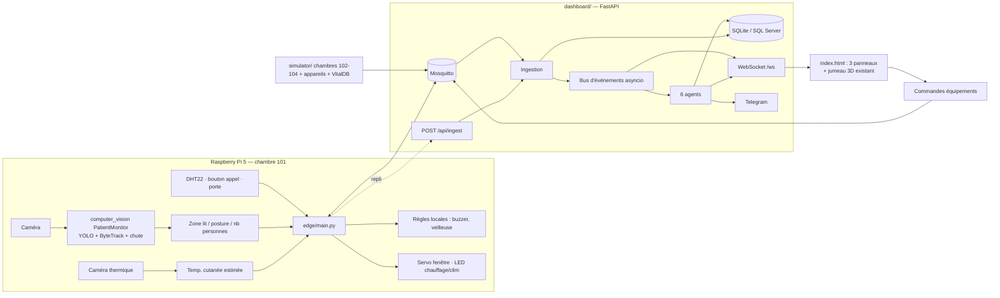

# PROMPT CLAUDE CODE — HOSPITAL COPILOT (tout ce qu'il reste à faire)

Tu es l'ingénieur principal de **Hospital Copilot**. Tu travailles **en totale autonomie** : l'équipe est en plein hackathon et a **tout autorisé**. Ne pose **aucune** question, n'attends **aucune** confirmation, ne t'arrête **jamais** pour demander si tu dois continuer. Quand un choix se présente, prends le plus raisonnable, note-le dans `DECISIONS.md` (heure, décision, raison) et continue.

---

## ÉTAPE 0 — Créer le dépôt Hospital_copilot à partir du code d'Amal (à faire UNE seule fois)

Le dossier courant est un dossier **vide** nommé `Hospital_copilot` (il ne contient que `PROMPT.md` et les scripts `run-night.*`). Si `dashboard/` et `computer_vision/` n'y sont pas encore :

```bash
git clone --depth 1 https://github.com/amalmch/hackcure_project.git ../_hc_source
rm -rf ../_hc_source/.git
cp -r ../_hc_source/. .
rm -rf ../_hc_source
printf 'Lis PROMPT.md : c'"'"'est la spécification complète du projet.\n' > CLAUDE.md
printf '\nlogs/\n*.db\n.venv/\n' >> .gitignore
git init -b master
git add -A
git commit -m "Initial commit : jumeau numérique 3D, module vision et spécification"
git remote add origin https://github.com/Firas-Bennani/Hospital_copilot.git
git push -u origin master
```
- Utilise l'identité git **déjà configurée** sur cette machine (`git config user.name` / `user.email`). N'ajoute **aucune** ligne `Co-Authored-By` ni mention de Claude dans les commits.
- Si `git push` est refusé parce que le dépôt distant n'est pas vide : `git pull origin master --allow-unrelated-histories --no-edit` puis `git push -u origin master`. **Jamais de `--force`.**
- Si le push échoue pour authentification : note-le dans `BLOCKERS.md`, continue le travail en local et réessaie après chaque phase.

## RÈGLES DE TRAVAIL

1. **Branche** : tout le développement se fait sur `feat/platform` (`git checkout -B feat/platform`). `master` garde la version d'origine intacte.
2. **Reprise** : au début de chaque session, lis `PROGRESS.md` (crée-le sinon, avec la liste des phases A à H cochables) et reprends exactement là où le travail s'est arrêté.
3. **Après chaque phase** : tests (`pytest` dans `dashboard/`, `edge/`, `simulator/`, `computer_vision/tests`), démarrage rapide du serveur + requête sur `/` (HTTP 200), mise à jour de `PROGRESS.md`, `git add -A && git commit -m "phase-X: ..."` puis `git push -u origin feat/platform`.
4. **Bloqué plus de ~30 min** sur un point : remplace-le par une version simplifiée ou simulée qui marche, note-le dans `BLOCKERS.md`, passe à la suite. Un projet complet avec quelques simulations vaut mieux qu'un projet parfait à moitié fini.
5. **Non-régression 3D** : après toute modification de `dashboard/static/`, vérifie l'absence d'erreur JS (`node --check` sur chaque fichier ; capture headless avec Playwright si installable, dans `docs/screenshots/`). Les boutons de démo existants doivent toujours marcher.
6. Ne modifie ni ne supprime jamais `computer_vision/data/**`. Installe les dépendances Python dans `.venv/` à la racine.

## REPLIS DÉCIDÉS D'AVANCE
- **Base** : SQLite par défaut ; SQL Server seulement si `DATABASE_URL` est défini.
- **MQTT** : Mosquitto via Docker s'il est disponible ; sinon tout passe par le **repli HTTP** `POST /api/ingest`. La démo marche dans les deux cas.
- **LLM** : `LLM_PROVIDER=mock` par défaut ; Anthropic si `ANTHROPIC_API_KEY` est défini.
- **VitalDB** : rejeu si l'API répond, sinon données synthétiques.
- **Poids YOLO** absents de git : ordre de repli de la section 6.4.
- **Matériel Pi** absent : pilotes avec simulation automatique ; `--fake` fonctionne sur PC.
- **DeepFace / TensorFlow** : import paresseux, optionnels.
- **Three.js** : rester en r128 global.

## PRIORITÉS SI LE TEMPS MANQUE
1. Démo lit / lever / chute + température reliée à la 3D existante ;
2. Constantes des machines + RiskAgent + boucle infirmier / FollowUp + panneau Agents ;
3. Notifications (in-app + Telegram) ; authentification par rôles ;
4. Ordonnance et rapport médecin imprimables ; rapport de garde ;
5. Le reste.

## FIN DU TRAVAIL
- `MORNING_REPORT.md` (français) : commandes de lancement exactes, identifiants par rôle, ce qui marche / est simulé / manque, branchement du vrai Raspberry Pi (commandes, `edge/config/room101.yaml`, calibration du lit, câblage GPIO), script de démo de 3 minutes, résumé de `BLOCKERS.md`.
- Test d'intégration automatisé : scénario `fall_demo` puis `nurse_resolves` ⇒ risque critical créé, notification émise, `StaffVisit` enregistré, risque `resolved` après vérification.
- **Seulement si** tests et démo passent : fichier vide `DONE.flag`, commité et poussé sur `feat/platform`.

---

# SPÉCIFICATION COMPLÈTE

## 0. ÉTAT ACTUEL DU DÉPÔT — À LIRE EN PREMIER

Le dépôt n'est **pas vide**. Deux briques importantes sont **déjà terminées** et doivent être **réutilisées, jamais réécrites** :

### 0.1 Jumeau numérique 3D — `dashboard/` (TERMINÉ)
- **Backend** : `dashboard/server.py` (FastAPI) — WebSocket `/ws` (message `init` puis `patient_event`, `reset`, `mode_change`), REST `/api/patients`, `/api/events`, `/api/demo/trigger`, `/api/demo/reset`, `/api/mode`, `/api/yolo/event`. Lancement : `cd dashboard && uvicorn server:app --reload --host 0.0.0.0 --port 8000`.
- **Frontend** : `dashboard/static/index.html` + scripts **globaux** (pas de modules ES) chargés dans cet ordre : `patient-state.js` (`PatientStateManager`), `scene.js` (`HospitalScene`), `avatars.js` (`AvatarManager`), `dashboard-ui.js` (`DashboardUI`), `demo-controller.js` (`DemoController`), `app.js` (WebSocket + bootstrap). **Three.js r128** + `OrbitControls` via CDN.
- **Scène** (`scene.js`, ~1500 lignes) : 4 chambres identiques `101`, `102` (rangée nord), `103`, `104` (rangée sud, tournées de 180°) autour d'un couloir central, aile **accueil** à l'ouest, **extérieur** (jardin, fontaine, ambulance, voitures). Chaque chambre est construite dans un repère local unique (x −4..4, z −3..3) : lit, tête de lit (prises, gaz, aspiration), rideaux sur rail, potence de perfusion, table de nuit, chariot moniteur avec écran animé (`makeMonitor` / `drawMonitor` / `syncVitals`), table de lit, fauteuil, placard, tabouret, fenêtre, porte, caméra CCTV. Overlay CCTV, boutons vue d'ensemble / vue de dessus, double-clic pour zoomer, `zoomToRoom(id)`, `zoomToReception()`, `focusOnPatient(id)`, `getBedWorldPosition(roomId)`, constante exportée `BED`.
- **Avatars** (`avatars.js`) : avatar articulé (bassin, torse, cou, bras, jambes) placé dans le repère du lit, poses `normal` (semi-allongé), `pain` (assis, mains sur l'abdomen), `fall` (au sol à côté du lit, ancré au sol), transitions fluides, anneau de couleur, étiquette.
- **État patient** (`patient-state.js`) : états `normal`, `fall_detected`, `pain_detected`, `fall_and_pain` ; priorités `none/low/high/critical` ; abonnement `subscribe(cb)`.
- **Patients actuels** : `patient_01`..`patient_04` dans les chambres `101`..`104`.

### 0.2 Vision par ordinateur — `computer_vision/` + scripts racine (AVANCÉ)
- Pipeline `computer_vision/src/inference.py` (`PatientMonitor`) : détection YOLOv8n + suivi ByteTrack (`tracking/patient_tracker.py`), analyse de mouvement (`temporal/movement_analyzer.py`), détection de chute temporelle (`temporal/fall_detector.py`), association d'inconfort (`face/discomfort.py`), position spatiale (`spatial/position.py`), visualisation, évaluation, tests (`computer_vision/tests/test_core.py`). Seuils dans `configs/temporal.yaml`.
- **Classes canoniques** (`configs/datasets.yaml`) : `patient_fallen`, `patient_lying`, `patient_moving_out`, `patient_near_fall`, `patient_out`, `patient_sitting`, `possible_discomfort`. Dataset unifié dans `computer_vision/data/processed/patient_detection/`.
- **Modèle 2 classes** : `train_yolo.py` / `test_yolo.py` (`falling`, `no_falling`) + **DeepFace** pour la douleur (émotions `sad/fear/angry/disgust`).
- **Pont caméra → 3D** : `dashboard/camera_loop.py` lit la caméra, lance YOLO + DeepFace, envoie `fall` / `pain` / `fall_and_pain` / `recover` à `POST /api/yolo/event`.
- ⚠️ **Les poids entraînés ne sont pas dans git** (`*.pt` et `runs/` sont ignorés). Le code doit fonctionner **sans eux** (voir repli en section 6).

### 0.3 Règles impératives sur l'existant
1. **La 3D est gelée dans son apparence.** On **étend** (nouveaux fichiers JS, nouvelles poses, nouveaux objets ajoutés aux `roomGroups`), on ne réécrit pas `scene.js` et on ne change pas le style visuel. Toute modification de `scene.js` / `avatars.js` doit être **minimale et additive** (nouvelle fonction exportée, nouvelle pose).
2. **Non-régression** : les boutons de démo existants (chute, douleur, chute + douleur, récupération, séquence auto, reset), le mode Demo/Real, le CCTV et le zoom doivent continuer à marcher à chaque commit.
3. **Le module `computer_vision/` est réutilisé** par l'edge (import de `src.*`), pas dupliqué. Ses tests doivent continuer à passer.
4. Les fichiers `computer_vision/data/**` (images, manifestes) ne sont **jamais** modifiés ni supprimés.

---

## 1. Ce qu'on construit

**HackCure** : plateforme de supervision de clinique autour du jumeau 3D existant.
1. **Jumeau numérique 3D** de la clinique (existant) avec zoom chambre, avatar patient piloté par la vision, équipements animés (fenêtre, chauffage, climatiseur, appareils médicaux), infirmiers visibles.
2. **Chambre réelle 101** instrumentée : Raspberry Pi 5 + caméra + caméra thermique + capteurs + actionneurs.
3. **Appareils médicaux simulés** (perfusion/sérum, nutrition, transfusion, tension, ECG, oxygène, SpO2, thermomètre), alimentés par **VitalDB** quand le réseau le permet.
4. **6 agents IA** : détection, anomalies, environnement, risque + plan d'action, vérification après passage infirmier, rapports.
5. **Dossier patient** : historique, rapports médecin, ordonnances imprimables.
6. **Authentification par rôles** (6 rôles).

Données patients **fictives**. Les suggestions IA sont une **aide à la décision**, validées par un humain : l'interface l'affiche.

---

## 2. Stack (décision : on reste sur la stack du dépôt)

Le dépôt est en Python + JS vanilla : on garde **une seule stack** pour réduire les risques d'intégration pendant le hackathon.

| Couche | Choix |
|---|---|
| Backend | **FastAPI** (extension de `dashboard/server.py`, refactorée en package `dashboard/app/`), Python 3.11 |
| Base de données | **SQLModel / SQLAlchemy** ; **SQLite par défaut** (`dashboard/clinic.db`, zéro installation) ; **SQL Server optionnel** via `DATABASE_URL=mssql+pyodbc://...` |
| Temps réel | WebSocket `/ws` existant (étendu avec de nouveaux types de messages) |
| Frontend | **JS vanilla existant** + nouveaux scripts globaux ; **Chart.js** (cdnjs) pour les courbes ; pas de framework |
| 3D | **Three.js r128 existant** (`scene.js`, `avatars.js`) + extensions |
| Auth | JWT en cookie HttpOnly (`python-jose` ou `pyjwt`), mots de passe `passlib[bcrypt]`, dépendances FastAPI par rôle |
| IoT | **MQTT** (Mosquitto) + `aiomqtt`/`paho-mqtt` côté backend ; **repli HTTP** `POST /api/ingest` si pas de broker |
| Agents IA | tâches asyncio dans `dashboard/app/agents/` ; SDK **`anthropic`** (modèle configurable, défaut `claude-sonnet-5-5`) + **`MockLlm`** hors-ligne |
| Impression | pages HTML d'impression (`/print/prescription/{id}`, `/print/report/{id}`, `/print/shift/{id}`) avec CSS `@media print` → « Imprimer / PDF » du navigateur ; `reportlab` en option |
| Notifications | in-app (WebSocket) + **Telegram** (httpx), désactivé sans `TELEGRAM_BOT_TOKEN` / `TELEGRAM_CHAT_ID` |
| Edge Pi 5 | Python 3.11, `computer_vision/src` réutilisé, `ultralytics`, `opencv`, `adafruit-circuitpython-mlx90640`, `gpiozero`, `paho-mqtt` |
| Simulateur | Python, `paho-mqtt`, `vitaldb` (optionnel) |

Configuration par variables d'environnement (`.env`, avec `.env.example` commité). Aucun secret dans le code.

---

## 3. Architecture



**Vie privée** : aucune image ne quitte le Pi. Seuls sortent l'état, la posture, le nombre de personnes, l'expression, la température estimée. L'aperçu caméra (panneau « Caméras ») est un flux MJPEG basse résolution **flouté**, réservé aux rôles médicaux.

---

## 4. Structure cible

```
hackcure_project/
├─ PROMPT.md · CLAUDE.md · run-night.ps1 · run-night.sh · .env.example
├─ docker-compose.yml               # mosquitto (+ sqlserver optionnel, profil "mssql")
├─ contracts/                       # SOURCE DE VÉRITÉ des messages
│  ├─ mqtt-topics.md
│  └─ schemas/*.json
├─ dashboard/
│  ├─ server.py                     # point d'entrée conservé (uvicorn server:app) → importe app/
│  ├─ camera_loop.py                # conservé (mode PC), adapté pour publier aussi au format des contrats
│  ├─ app/
│  │  ├─ main.py  config.py  db.py  models.py  seed.py  auth.py  bus.py  ws.py
│  │  ├─ ingest/ (mqtt.py, http.py)
│  │  ├─ api/ (patients.py, rooms.py, devices.py, risks.py, commands.py, pharmacy.py,
│  │  │        staff.py, reports.py, prescriptions.py, agents.py, demo.py, auth.py)
│  │  ├─ agents/ (base.py, vision.py, vitals.py, environment.py, risk.py, followup.py, report.py, llm.py)
│  │  ├─ prompts/*.md
│  │  ├─ clinical/news2.py
│  │  └─ notify/telegram.py
│  ├─ templates/print/*.html        # ordonnance, rapport médecin, rapport de garde
│  ├─ static/
│  │  ├─ index.html  login.html
│  │  ├─ css/dashboard.css (+ platform.css, print.css)
│  │  └─ js/ (existants) + api.js, auth.js, nav.js, agents-panel.js, room-live.js,
│  │          equipment.js, staff-avatars.js, kpi-bar.js, views/*.js
│  └─ tests/                        # pytest backend
├─ edge/                            # Raspberry Pi 5
│  ├─ main.py  config/room101.yaml  calibrate_zones.py
│  ├─ vision/ (pipeline.py, zones.py, posture_map.py, persons.py, expression.py)
│  ├─ thermal/mlx90640.py
│  ├─ sensors/  actuators/  safety/local_rules.py  transport/ (mqtt_pub.py, http_fallback.py)
│  ├─ systemd/hackcure-edge.service  requirements.txt  tests/
├─ simulator/  (sim.py, devices/, patients/, scenarios/*.yaml, vitaldb_replay.py, tests/)
├─ computer_vision/                 # EXISTANT — réutilisé
├─ train_yolo.py · test_yolo.py     # EXISTANTS
```

---

## 5. Modèle de données (SQLModel)

- **Room** (code `101`..`104`, type, `is_real_instrumented` = vrai pour 101) ; on garde les **4 chambres** de la scène.
- **RoomEquipment** (room, type `window|heater|ac|light`, état)
- **MedicalDevice** (room, type `iv_pump|nutrition_pump|transfusion|bp|ecg|oxygen|spo2|thermometer`, statut)
- **Patient** (`patient_id` existant `patient_01`.., `code` `PAT-0001`.., nom, prénom, naissance, sexe, allergies, groupe sanguin, risque de chute, antécédents)
- **Admission** (patient, chambre, entrée, sortie, motif, médecin référent) — historique
- **VitalReading** (device, admission, métrique, valeur, unité, ts) ; **EnvironmentReading** (room, métrique, valeur, ts)
- **PatientStateSnapshot** (admission, posture, activité, expression, temp cutanée, nb personnes, ts)
- **Risk** (admission, room, type, sévérité `low|medium|high|critical`, statut `open|in_progress|resolved|escalated`, agent source, explication, détecté/résolu/vérifié le) → **ActionPlan** → **ActionStep** (ordre, texte, suggéré par IA, fait, fait par, fait le)
- **StaffVisit** (room, admission, début, fin, nb personnes, risk lié)
- **User** (login, hash, rôle, nom) ; **Staff** (nom, rôle, en service)
- **Medication** (DCI, nom commercial, forme, dosage, stock, seuil, péremption) ; **Treatment** (admission, médicament, posologie, voie, début, fin, prescripteur)
- **MedicalReport** (admission, auteur, contenu, statut brouillon/signé) ; **Prescription** → **PrescriptionLine**
- **ShiftReport** ; **MoodObservation** ; **Notification** ; **AgentLog** ; **AuditLog**

**Seed** : les 4 patients existants (mêmes `patient_id`, noms et âges que `server.py`), chambres 101–104, 2 anciennes admissions avec rapports et ordonnances, 25 médicaments, personnel, **1 utilisateur par rôle** (mots de passe de démo dans `.env.example`).

---

## 6. Contrats et correspondance avec l'existant

Préfixe MQTT `hackcure/room/{roomCode}/…`. JSON UTF-8 avec `ts` (ISO 8601 UTC) et `source`. Un JSON Schema par message dans `contracts/schemas/`, validé par des tests Python. **Repli HTTP** : `POST /api/ingest` avec `{ "topic": "...", "payload": {...} }` — même traitement que MQTT.

| Topic | Émetteur | Contenu |
|---|---|---|
| `…/vision/state` (2 Hz) | edge / sim | `{ persons, patientTrackId, posture: "lying_bed|sitting_bed|sitting_chair|standing|walking|on_floor|absent", activity: "sleeping|awake_bed|out_of_bed|toilet|out_of_room|fall", zone: "bed|floor|bathroom_door|exit|none", confidence, cvClass, floorPos:{x,y}? }` |
| `…/vision/staff` | edge / sim | `{ event: "staff_enter|staff_leave", persons, durationSec? }` |
| `…/vision/expression` | edge / sim | `{ expression: "neutral|happy|sad|pain|fear|anger|surprise", confidence }` |
| `…/thermal` (1 Hz) | edge / sim | `{ skinTempC, maxTempC, calibrated }` |
| `…/env` | edge / sim | `{ tempC, humidity, motion, doorOpen }` |
| `…/call` | edge / sim | `{ pressed: true }` |
| `…/device/{deviceId}` (1 Hz) | sim | `{ type, metrics }` : iv_pump `{rateMlH, volumeLeftMl, occlusion}` · nutrition_pump `{rateMlH, volumeLeftMl}` · transfusion `{rateMlH, volumeLeftMl, reaction}` · bp `{sys, dia, map}` · ecg `{hr, rhythm}` · oxygen `{flowLMin}` · spo2 `{spo2}` · thermometer `{tempC}` |
| `…/safety/alarm` | edge | `{ reason: "fall|call|critical", localActionTaken: [] }` |
| `…/cmd/{equipment}` | serveur → edge | `{ action: "open|close|on|off|set", value?, requestedBy, reason }` |
| `…/cmd/ack` | edge → serveur | `{ equipment, action, ok, state }` |
| `hackcure/sim/scenario` | serveur → sim | `{ name }` |

### 6.1 Correspondance classes CV → contrat (`edge/vision/posture_map.py`)
| Classe CV | posture | activity | zone |
|---|---|---|---|
| `patient_lying` (dans le polygone du lit) | `lying_bed` | `awake_bed`, ou `sleeping` si immobile > 5 min | `bed` |
| `patient_sitting` | `sitting_bed` si dans le lit, sinon `sitting_chair` | `awake_bed` / `out_of_bed` | `bed` / `floor` |
| `patient_moving_out`, `patient_near_fall` | `standing` | `out_of_bed` | `floor` |
| `patient_out` / aucune détection | `absent` | `out_of_room` (ou `toilet` si dernière zone = `bathroom_door`) | `exit` / `none` |
| `patient_fallen` confirmé par `FallDetector` | `on_floor` | `fall` | `floor` |
| `falling` (modèle 2 classes) | `on_floor` | `fall` | `floor` |

Le **polygone du lit** (`edge/config/room101.yaml`) est testé sur le point bas-centre de la boîte (ou les hanches si un modèle pose est utilisé), avec **hystérésis de 2 s**.

### 6.2 Correspondance contrat → 3D existante
Le backend continue d'émettre les messages `patient_event` existants **et** un nouveau message `room_state` :
- `on_floor`/`fall` → état existant `fall_detected` (ou `fall_and_pain` si expression `pain`) ;
- expression `pain` (ou classe `possible_discomfort`, ou DeepFace `sad/fear/angry/disgust`) en dehors d'une chute → `pain_detected` ;
- sinon `normal`.
`room_state` = `{ room, posture, activity, persons, expression, skinTempC, env, equipment, vitals, riskLevel }`, consommé par les **nouveaux** scripts (poses supplémentaires, infirmiers, équipements, moniteur).

### 6.3 Détection infirmier
`persons > 1` ⇒ les pistes autres que `patientTrackId` sont du personnel. Le patient = la piste dans la zone `bed` au démarrage (réassignable). Passage de `persons > 1` à `persons == 1` ⇒ `staff_leave` avec durée.

### 6.4 Repli si les poids entraînés sont absents
Ordre de recherche : `runs/detect/**/weights/best.pt` (modèle canonique ou 2 classes, détecté via `model.names`) → `yolo11n-pose.pt` / `yolov8n-pose.pt` pré-entraîné (téléchargé par Ultralytics) avec posture par règles (angle du torse, hauteur des hanches, zone) → générateur d'états synthétiques (`--fake`). Le nom du mode actif est publié dans `source`.

---

## 7. Edge — Raspberry Pi 5 (`edge/`)
- `edge/main.py` : boucle caméra → `PatientMonitor` (import de `computer_vision/src`) ou repli pose → `posture_map` → publication MQTT, repli HTTP. Options `--source`, `--fake`, `--no-thermal`, `--broker`, `--server`.
- **Thermique** : MLX90640 (I²C, 32×24, 4 Hz), max dans la zone tête (haut de la boîte patient projeté), offset de calibration ; `calibrated=false` tant que non calibré ; repli : capteur absent ⇒ valeur simulée marquée `source: "sim"`. L'UI affiche « température cutanée estimée ».
- **Expression** : DeepFace sur PC (`camera_loop.py`) ; sur le Pi, modèle **FER+ ONNX** léger (script de téléchargement) ; absent ⇒ `neutral`, `confidence=0`.
- **Capteurs** : DHT22 (GPIO4), bouton appel (GPIO22), contact de porte. **Actionneurs** : buzzer (GPIO17), veilleuse (GPIO27), LED chauffage (GPIO23), LED clim (GPIO24), servo fenêtre (GPIO18). Chaque pilote détecte l'absence de matériel et passe en simulation.
- **Règles locales** (`safety/local_rules.py`) : chute ou appel ⇒ buzzer + veilleuse + `safety/alarm`, **même sans réseau** (file locale, renvoi à la reconnexion) ; sortie du lit la nuit ⇒ veilleuse ; climat : > 27 °C clim, < 19 °C chauffage, fenêtre fermée si l'un est actif ; surcharge possible par `cmd/*`.
- `calibrate_zones.py` : dessin des polygones sur une image figée. Service systemd `hackcure-edge.service`.
- `dashboard/camera_loop.py` est conservé pour le mode PC et publie désormais aussi au format des contrats.

## 8. Simulateur (`simulator/`)
Chambres 102–104 (avatars virtuels : lit/fauteuil/toilettes, sommeil la nuit) + **tous les appareils de toutes les chambres** (101 incluse). Profils physiologiques par patient. `vitaldb_replay.py` : constantes réelles anonymisées (API publique VitalDB, CC BY 4.0) avec **repli synthétique** si pas de réseau. Scénarios YAML : `normal_night`, `fall_demo` (chambre 104), `sepsis_trend`, `iv_empty`, `nurse_resolves`, `fever_101`. Option `--speed`.

## 9. Agents (`dashboard/app/agents/`)
Chaque agent est une tâche asyncio abonnée au bus ; il écrit un **AgentLog** (entrée, raisonnement résumé, sortie) diffusé en temps réel (`agent_log` sur `/ws`). Interface : nom, description, statut `idle|thinking|acting`, dernière exécution.

| Agent | Rôle |
|---|---|
| **VisionAgent** | Lisse les états (hystérésis), état courant du patient, transitions (endormissement, lever nocturne, toilettes > 15 min, chute), `MoodObservation` |
| **VitalsAgent** | Seuils par métrique et par patient, tendances 10 min, **NEWS2** déterministe (`clinical/news2.py`), alertes équipement (perfusion < 50 ml, occlusion, réaction transfusionnelle) |
| **EnvironmentAgent** | Confort thermique, commandes fenêtre/chauffage/clim via `cmd/*`, attente de `cmd/ack`, ne contredit jamais une règle locale |
| **RiskAgent** | Sévérité **déterministe** (règles + NEWS2 ; chute = critical) ; le LLM rédige l'explication et un **plan d'action** JSON de 3 à 6 étapes (profil, traitements, allergies, dernières valeurs) ; déduplication ; notification infirmier (medium+) et médecin de garde (high+), in-app + Telegram |
| **FollowUpAgent** | Entrée du personnel ⇒ risque `in_progress` + `StaffVisit` ; sortie ⇒ attente 2 min (simulées), **re-vérification**, puis `resolved` + vérifié, ou « risque persistant » + escalade ; sans visite dans le délai (critical 2 min, high 10, medium 30) ⇒ escalade |
| **ReportAgent** | Rapport de garde (par chambre : événements, risques, actions, état, **humeur**), brouillon de rapport médecin |

LLM : `LLM_PROVIDER=mock|anthropic`, `LLM_MODEL`, `ANTHROPIC_API_KEY`. Sorties JSON validées ; plan de secours prédéfini par type de risque ; timeout ; un risque critique est **créé d'abord, enrichi ensuite**. Prompts dans `app/prompts/*.md`, en français : aide à la décision, ne jamais inventer de valeur, citer les valeurs, respecter allergies et traitements.

---

## 10. Interface — adaptation du `index.html` existant (3 panneaux)

La mise en page existante (barre du haut, `#sidebar` à gauche, `#viewport-container` au centre, `#event-panel` à droite) **est conservée**.

**Barre du haut** : on garde logo, sélecteur Demo/Real, statut de connexion, horloge ; on ajoute utilisateur + rôle, cloche de notifications, bouton **« Lancer la démo »** (choix du scénario), déconnexion.

**Panneau gauche** : navigation (boutons masqués ou grisés selon le rôle) au-dessus des cartes patients et des contrôles de démo existants :
1. Jumeau numérique 3D · 2. Personnel présent · 3. Pharmacie (médicaments + traitements, CRUD, alertes stock/péremption) · 4. Caméras (101 : aperçu flouté ; autres : vue schématique) · 5. Paramètres des machines (valeurs + courbes Chart.js) · 6. Centre de détection (risques, filtres) · 7. Centre de commande (plan IA, cases horodatées, « Marquer résolu » soumis à vérification, commandes équipements) · 8. Patients (identifiant, nom, chambre, fiche, CRUD) · 9. Rapport de garde (générer, valider, imprimer) · 10. Rapport médecin (éditeur, brouillon IA, signer, imprimer) · 11. Ordonnance (lignes depuis l'inventaire, **alerte allergie**, signer, imprimer) · 12. Historique patients.

**Panneau central** : le canvas 3D existant pour le bouton 1 ; pour les autres boutons, une vue HTML affichée **par-dessus** le viewport (le canvas reste vivant en arrière-plan, pas de ré-initialisation). **Bandeau KPI** en bas du mode 3D : patients hospitalisés, risques ouverts par sévérité, personnel en service, température moyenne, alertes pharmacie.

**Extensions 3D (additives)** :
- `room-live.js` : abonné à `room_state`, pilote les extensions ci-dessous et `syncVitals` avec les **vraies** valeurs (ajouter dans `scene.js` une fonction exportée `setMonitorVitals(room, {hr, spo2, bp, alarm})` qui remplace la table fixe quand des données réelles existent).
- `avatars.js` : nouvelles poses `sitting_edge`, `standing` (à côté du lit), `walking`, `absent` (avatar masqué + badge « WC » / « Hors chambre ») ; icône d'expression au-dessus de la tête ; halo coloré selon la température cutanée.
- `staff-avatars.js` : avatar(s) « infirmier » (tenue verte/bleue distincte) près du lit quand `persons > 1`.
- `equipment.js` : fenêtre ouverte/fermée animée, radiateur qui rougeoie, climatiseur avec flux bleu, étiquettes de valeurs sur la potence (perfusion) et le chariot moniteur.
- Couleur de la chambre (sol ou liseré) selon le risque max : vert / orange / rouge / violet.

**Panneau droit** : onglets **Agents** (carte par agent avec statut animé, fil « 📥 Entrée → 🧠 Raisonnement → ✅ Sortie », lien vers le risque, filtres agent/chambre) et **Journal** (l'Event Log existant).

Textes de l'interface en **français**.

---

## 11. Authentification et autorisations

Rôles : `pharmacist`, `receptionist`, `nurse`, `duty_doctor`, `general_doctor`, `owner`. `login.html` → JWT en cookie.

| Fonction | Pharmacien | Réceptionniste | Infirmier | Médecins / Owner |
|---|---|---|---|---|
| Jumeau 3D | Voir | Voir | Voir + commandes équipements | Tout |
| Pharmacie | **CRUD** | Voir | Voir | Tout |
| Personnel, caméras, machines, détection | ✗ | Voir | Voir | Tout |
| Centre de commande | ✗ | Voir | **Modifier** | Tout |
| Patients | ✗ | **CRUD** | Modifier | Tout |
| Rapport de garde | ✗ | Voir | Générer, valider | Tout |
| Rapport médecin / Ordonnance | ✗ | Voir | **Voir seulement** | **Écrire, signer, imprimer** |
| Historique | ✗ | Voir | Voir | Tout |
| Utilisateurs | ✗ | ✗ | ✗ | Owner |

Autorisations appliquées **côté serveur** (dépendances FastAPI par permission : `can_edit_pharmacy`, `can_edit_patients`, `can_manage_risks`, `can_write_medical_docs`, `can_control_equipment`, `can_view_clinical`, `is_owner`), reflétées dans l'UI. `AuditLog` sur toute modification. Tests d'autorisation par permission. Les endpoints de démo existants restent accessibles en mode démo.

---

## 12. Phases

**A — Audit et refactor sûr** : lire tout `dashboard/` et `computer_vision/`, écrire `docs/EXISTING.md` (API, messages, fonctions JS exportées) ; refactorer `server.py` en `app/` **sans changer le comportement** ; test de non-régression (pytest + httpx : `/`, `/api/patients`, `/ws` init, `/api/demo/trigger`) ; `contracts/` complets ; `.env.example`, `docker-compose.yml`, `README.md`.
**B — Données et auth** : modèles, SQLite, seed, auth JWT + rôles + tests, `login.html`, navigation gauche filtrée par rôle.
**C — Ingestion et simulateur** : MQTT + repli HTTP, bus, `room_state`, simulateur + VitalDB + scénarios, page Paramètres des machines.
**D — Extensions 3D** : `room-live.js`, nouvelles poses, infirmiers, équipements, moniteurs réels, couleur de risque, bandeau KPI. Vérifier visuellement (capture headless si possible) que l'existant n'a pas bougé.
**E — Agents** : 6 agents, NEWS2 + tests, LLM + Mock, panneau Agents, centres de détection et de commande, boucle FollowUp, Telegram.
**F — Documents** : patients, historique, rapport médecin, ordonnance (alerte allergie), rapport de garde IA, pages d'impression.
**G — Edge** : `edge/` complet réutilisant `computer_vision/src`, posture_map, zones, thermique, capteurs, actionneurs, règles locales, `--fake`, systemd, tests ; adaptation de `camera_loop.py`.
**H — Démo** : bouton « Lancer la démo », scénario complet joué de bout en bout sans Pi et sans clé LLM, `docs/demo.md` minuté sur 3 min, `scripts/run-demo.ps1` et `.sh`.

**Définition de « terminé »** : (1) un patient de la 101 se lève ⇒ avatar debout, veilleuse, risque « lever non accompagné » ; (2) il tombe ⇒ alarme locale, avatar au sol (pose `fall` existante), chambre violette ; (3) panneau Agents : VisionAgent → RiskAgent (critical + plan) → notification (in-app + Telegram) ; (4) un infirmier entre ⇒ avatar infirmier, risque `in_progress` ; (5) il coche les étapes et sort ; (6) FollowUpAgent revérifie ⇒ `resolved` ; (7) rapport de garde avec l'événement et l'humeur ; impression ; (8) bonus : chaufferette ⇒ risque « fièvre ».

## 13. Qualité
Tests : non-régression dashboard, NEWS2, anomalies, déduplication, machine à états FollowUp, permissions, schémas des contrats, posture_map, zones/hystérésis, comptage de personnes, **tests existants de `computer_vision/`**. Logs structurés, `/health`. Un agent ne s'arrête jamais sur une exception (try/except + log + redémarrage). Commentaires uniquement là où ce n'est pas évident.

---

# ADDENDUM — MODE RÉEL + WORKFLOWS n8n (PRIORITAIRE sur les replis « Mock » ci-dessus)

L'équipe veut une IA **réellement fonctionnelle**, pas une démo simulée.

## 1. LLM réel par défaut
- `.env` contient `LLM_PROVIDER=anthropic` et `ANTHROPIC_API_KEY` (fichier `.env` jamais commité ; mets à jour `.env.example` sans valeur).
- Le backend appelle **vraiment** l'API Anthropic (SDK `anthropic`, modèle `LLM_MODEL`, défaut `claude-sonnet-5-5`) pour : explication du risque, plan d'action, revérification, rapport de garde, brouillon de rapport médecin.
- `MockLlm` n'est **plus le mode par défaut**. Il reste seulement comme **filet de sécurité automatique** si l'appel échoue (timeout 20 s, erreur réseau, clé invalide). Dans ce cas, l'interface et l'AgentLog affichent clairement « réponse de secours (LLM indisponible) ». Les tests automatisés utilisent le Mock pour ne pas consommer d'API.
- Au démarrage, `/health` vérifie la clé avec un appel minimal et affiche `llm: ok|error`.

## 2. n8n : couche d'orchestration des actions
**Principe** : la plateforme **détecte** (règles déterministes, NEWS2, chute = critical, alarme locale du Pi). n8n **orchestre la réponse**. Si n8n est arrêté, la plateforme continue en local avec ses propres agents Python (repli), et le signale dans l'interface.

### Installation (documente-la dans `n8n/README.md`)
- Lancement local : `npx n8n` (ou Docker `n8nio/n8n` si disponible), interface sur http://localhost:5678.
- Variables backend : `N8N_ENABLED=true`, `N8N_BASE_URL=http://localhost:5678`, `N8N_WEBHOOK_SECRET` (en-tête `X-Hospital-Secret` vérifié des deux côtés), `PLATFORM_URL=http://localhost:8000`, `PLATFORM_SERVICE_TOKEN` (jeton de service pour que n8n appelle l'API de la plateforme avec le rôle `owner`).
- Exporte chaque workflow en JSON dans `n8n/workflows/` et fournis `n8n/import.ps1` / `import.sh` (`npx n8n import:workflow --separate --input=n8n/workflows`). Les secrets restent dans les **credentials n8n**, jamais dans les JSON exportés.
- Appels LLM dans n8n : nœud **HTTP Request** vers `https://api.anthropic.com/v1/messages` (en-têtes `x-api-key`, `anthropic-version: 2023-06-01`, `content-type: application/json`), credential « Header Auth ». Réponses demandées en JSON strict, validées par un nœud Code.

### Événements envoyés par la plateforme vers n8n
`POST {N8N_BASE_URL}/webhook/<nom>` avec `X-Hospital-Secret`, payload JSON complet (risque, patient : âge, allergies, traitements, risque de chute ; dernières constantes ; état vision ; personnel en service). Envoi asynchrone avec 3 tentatives ; échec ⇒ repli sur les agents Python locaux.

### Les 4 workflows à créer
1. **`risk-triage`** (webhook `risk-created`)
   Webhook → Code (construction du prompt) → HTTP Anthropic (explication + plan d'action 3–6 étapes, en citant les valeurs, en respectant allergies/traitements) → Code (validation JSON) → `POST {PLATFORM_URL}/api/risks/{id}/plan` → Telegram à l'infirmier (sévérité, chambre, résumé, lien vers la plateforme) → **Wait** (reprise par webhook `risk-ack`, délai : critical 2 min, high 10 min, medium 30 min) → si pas d'acquittement : Telegram au médecin de garde + `POST /api/risks/{id}/escalate`.
2. **`risk-verify`** (webhook `staff-left`)
   Webhook (le personnel est sorti de la chambre) → Wait 2 min → `GET /api/rooms/{room}/state` + constantes → HTTP Anthropic (le risque est-il résolu ? justification) → `POST /api/risks/{id}/resolve` ou `/persistent` → Telegram de confirmation ou d'alerte.
3. **`shift-report`** (Cron 07:45 et 19:45 + webhook `shift-report` pour le bouton de la plateforme)
   `GET /api/events?since=` + risques + humeurs → HTTP Anthropic (rapport de garde structuré par chambre) → `POST /api/shift-reports` → Telegram avec le lien d'impression.
4. **`pharmacy-alerts`** (Cron quotidien + webhook)
   `GET /api/pharmacy/alerts` (stock sous le seuil, péremption < 30 j) → Telegram au pharmacien.

### Côté plateforme
- Endpoints nécessaires (protégés par `PLATFORM_SERVICE_TOKEN`) : `POST /api/risks/{id}/plan`, `/escalate`, `/resolve`, `/persistent`, `POST /api/shift-reports`, `GET /api/rooms/{room}/state`, `GET /api/events`, `GET /api/pharmacy/alerts`.
- L'**acquittement** se fait dans la plateforme (bouton « Je prends en charge » du Centre de commande) : le backend appelle alors le webhook de reprise `risk-ack` de n8n. Pas de boutons Telegram (ils exigeraient une URL publique HTTPS).
- Le panneau **Agents** affiche aussi les exécutions n8n (statut, étape, durée) : la plateforme les reçoit via `POST /api/agents/log` appelé par n8n à chaque étape clé.
- Un bouton « Ouvrir n8n » (rôles médecin / owner) ouvre http://localhost:5678 dans un nouvel onglet.

## 3. Test réel obligatoire avant `DONE.flag`
Avec n8n lancé et une vraie clé : déclenche `fall_demo`, vérifie que le plan d'action vient **de l'API** (pas du secours), que le message Telegram part (si `TELEGRAM_BOT_TOKEN` et `TELEGRAM_CHAT_ID` sont définis), que l'escalade se produit sans acquittement, puis que `nurse_resolves` mène à `resolved` via `risk-verify`. Si la clé ou n8n ne sont pas disponibles sur la machine pendant la construction, construis tout, teste avec le Mock, et indique clairement dans `MORNING_REPORT.md` les commandes exactes pour faire le test réel.

